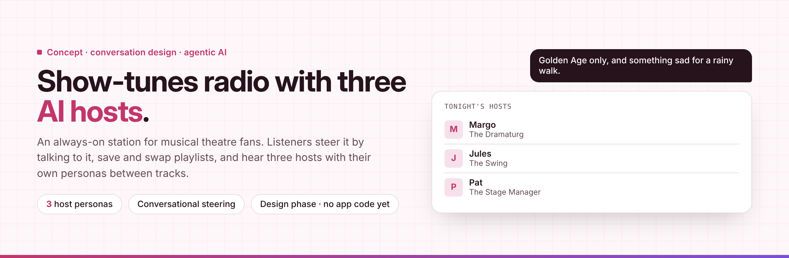

# Cuecast

24/7 show-tunes radio with three AI hosts.

Cuecast is an always-on station for musical theatre fans. Listeners steer it by talking to it ("Golden Age only," "nothing from *Les Mis* today," "something sad for a rainy walk"), save and swap playlists with other fans, and keep a diary of the shows they've seen. Three AI hosts with distinct personalities rotate through the day and talk between songs.

It's also a portfolio project. The app shows conversation design and agentic AI work end to end: intent design, persona systems, grounding, agent boundaries, recovery flows and evals.

> **Name status:** "Cuecast" blends "cue" and "broadcast." A first screen found no app with this name and only an abandoned 2012 CUECAST filing. It still needs a trademark attorney's review before public launch.

## Status

Concept and design phase. No app code yet.

## v1 scope

| Feature | What it does |
| --- | --- |
| Always-on station | A queue that never runs out and refills itself from the Apple Music catalog |
| Conversational steering | Requests by show, composer, era, mood or talk level change the queue |
| Three rotating hosts | Margo (the Dramaturg), Jules (the Swing) and Pat (the Stage Manager) talk between tracks |
| Save and swap | Publish playlists, save other fans' playlists and remix them with credit |
| Theatre diary | Log shows you've seen; pre-show playlists file themselves into the diary |

Planned for v2: spoiler-safe mode, a Claude connector (MCP) and expanded host breaks.

## How it works

### Playback

Playback uses Apple's MusicKit with `ApplicationMusicPlayer`, so songs play inside the app from the listener's own Apple Music subscription. Listeners without a subscription hear 30-second previews and see Apple's subscription offer sheet.

### The grounding rule

The model writes the words. Code picks the songs and checks every claim before anything plays.

1. **Pick.** The station engine chooses the next track from the catalog using rules, without the model.
2. **Fact card.** The engine builds a fact card from verified catalog data.
3. **Write.** The model writes the host break from the fact card, the host's persona sheet and the break's length limit.
4. **Check.** A validator confirms every name and number appears on the fact card, the line fits the limit, and it contains no lyrics or spoilers.
5. **Fall back.** A failed check uses a pre-written template line or skips the break.
6. **Voice.** Text-to-speech renders the line in the host's licensed synthetic voice.

### Agent boundaries

- Steering changes the queue first; the host then confirms what changed in one line.
- Anything that writes to the listener's account, such as saving to their library, takes a tap.
- Hosts talk only between tracks and never edit or blend song audio.

## Evals

| Eval | What it checks |
| --- | --- |
| Grounding | Every claim traces to the fact card |
| Blind host ID | An LLM judge can tell the hosts apart from unlabeled lines |
| Persona fit | Lines match each host's persona sheet |
| Talk budget | Airtime stays within each host's limit |
| Steering accuracy | The queue change matches the request |
| Confirmation accuracy | The host's line matches the actual queue change |

## Docs

- [Host bible](docs/host-bible.md): persona sheets, shared rules, scripts, recovery lines and evals

## Legal notes

- Song playback goes through Apple Music. The app does not run its own stream.
- Hosts quote no lyrics and imitate no real performers or broadcasters.
- Any use of WERS's Standing Room Only stream, name or logo needs the station's written permission.
